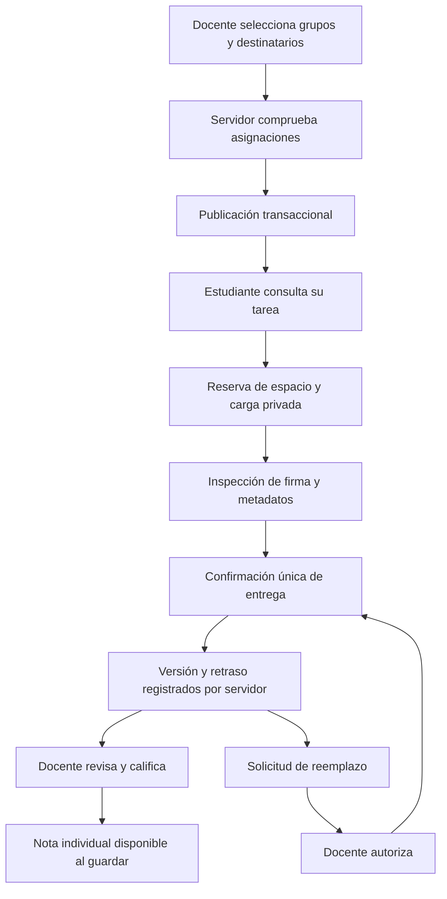
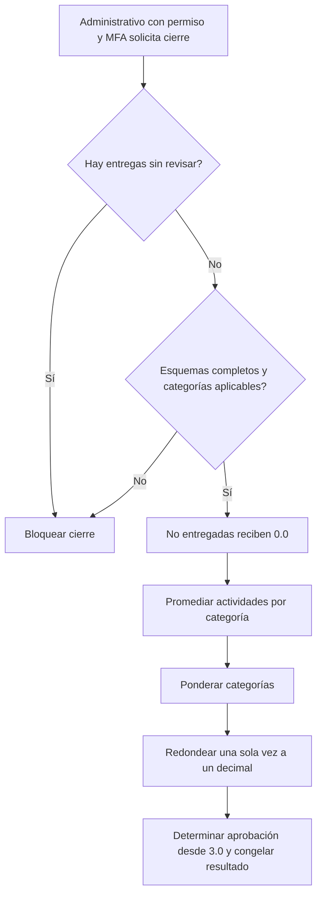

# Recorridos y conexiones preparados

Documento funcional, sin dirección visual elegida ni pantallas implementadas. Conserva el requisito de elegir el diseño con el usuario antes de construirlas.

## Navegación prevista

- Pública: presentación, oferta académica publicada, historia ficticia, precios ilustrativos, contacto y acceso.
- Estudiante: inicio, materias, detalle de materia, tarea, confirmación de entrega, conversación privada, notas, calendario, notificaciones y perfil.
- Docente: inicio, grupos, detalle de grupo, revisión por tarea o estudiante, creación con selección de destinatarios, rúbrica y perfil.
- Administrativo académico: carreras, materias, períodos, grupos, matrículas, esquema de evaluación, cierre y solicitudes de identidad; mostrar cada acción según permiso específico.
- Administrador del sistema: cuentas, invitaciones, roles y permisos, estados, doble autorización, conciliación y consumo; sin panel automático de notas.

## Tarea a calificación

Las operaciones de confirmación y publicación admiten Idempotency-Key para conservar el recibo de una intención durante 24 horas. El cliente debe reutilizar la misma clave al repetir esa intención tras una interrupción; generar una clave nueva en cada intento no evita duplicados.

## Cierre académico

El promedio provisional permanece explícitamente sin política configurada. La nota individual y el resultado cerrado sí tienen contrato. No se marca aprobado o reprobado durante un período abierto.

## Estados que deberá representar el frontend

- Datos cargando, vacío, servicio no disponible, permisos insuficientes, cuenta suspendida o archivada y sesión expirada.
- Tarea pendiente, entrega en curso, reserva pendiente de conciliar, inspección rechazada, entrega confirmada, fuera de plazo, revisión pendiente y nota guardada.
- Autorización de reemplazo disponible y consumida; conserva historial de versiones.
- MFA pendiente, invitación en curso, perfil pendiente de conciliar, eliminación solicitada, aprobada, en ejecución y finalizada.
- Presupuesto de almacenamiento lleno y límites temporales de solicitudes. Un error de carga no debe borrar una entrega confirmada ni crear otra versión automáticamente.

## Capa de cliente escrita

src/client/api.ts prepara sesión en memoria, renovación compartida y llamadas a la API. No persiste tokens en localStorage ni decide permisos decodificando claims en el navegador. src/client/evidence.ts reserva, carga, inspecciona y confirma mediante los contratos del servidor. No hay vistas o estilos nuevos.

La respuesta de la renovación o de una lectura anterior no debe restaurar una sesión cerrada. Esta intención está codificada mediante una generación de sesión; su comportamiento aún requiere las pruebas aplazadas.

## Selección pendiente

Se consultó al usuario la acción principal de la landing: explorar carreras, solicitar información o conocer la institución. Su respuesta y la selección visual siguen pendientes. No se registra una paleta, tipografía o composición como aprobada.
